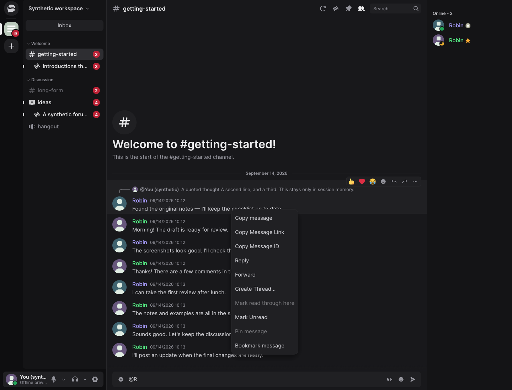
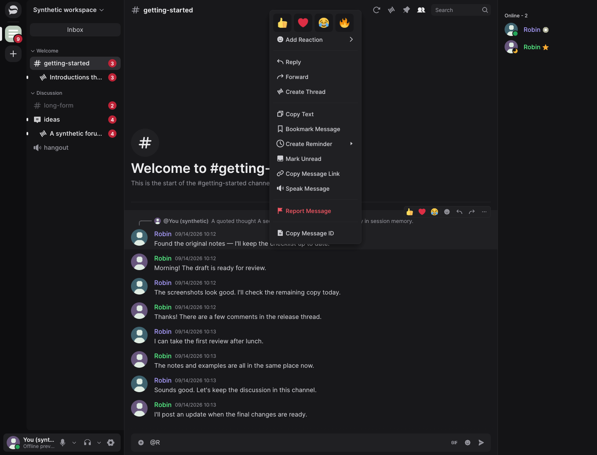
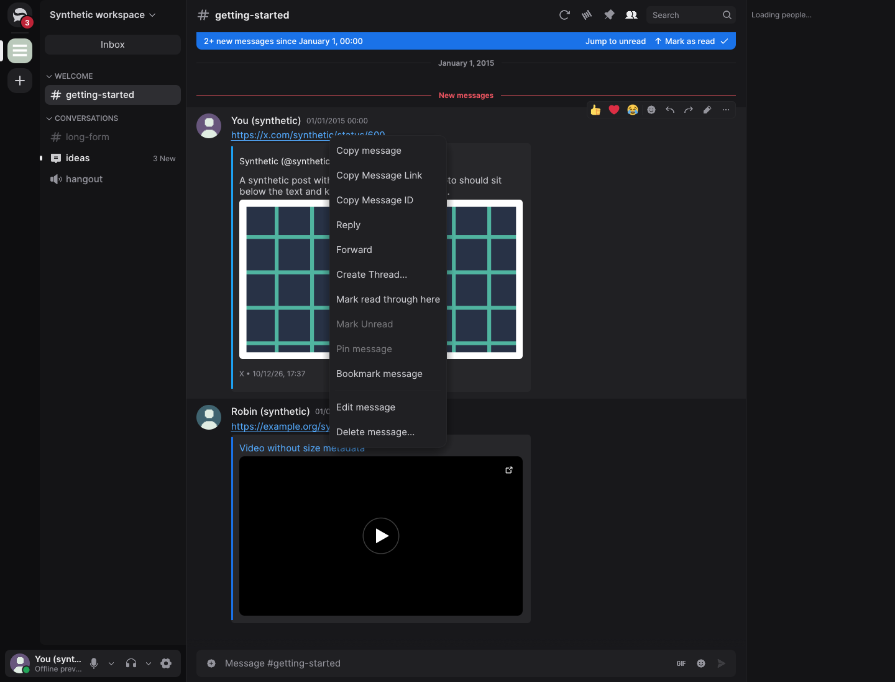
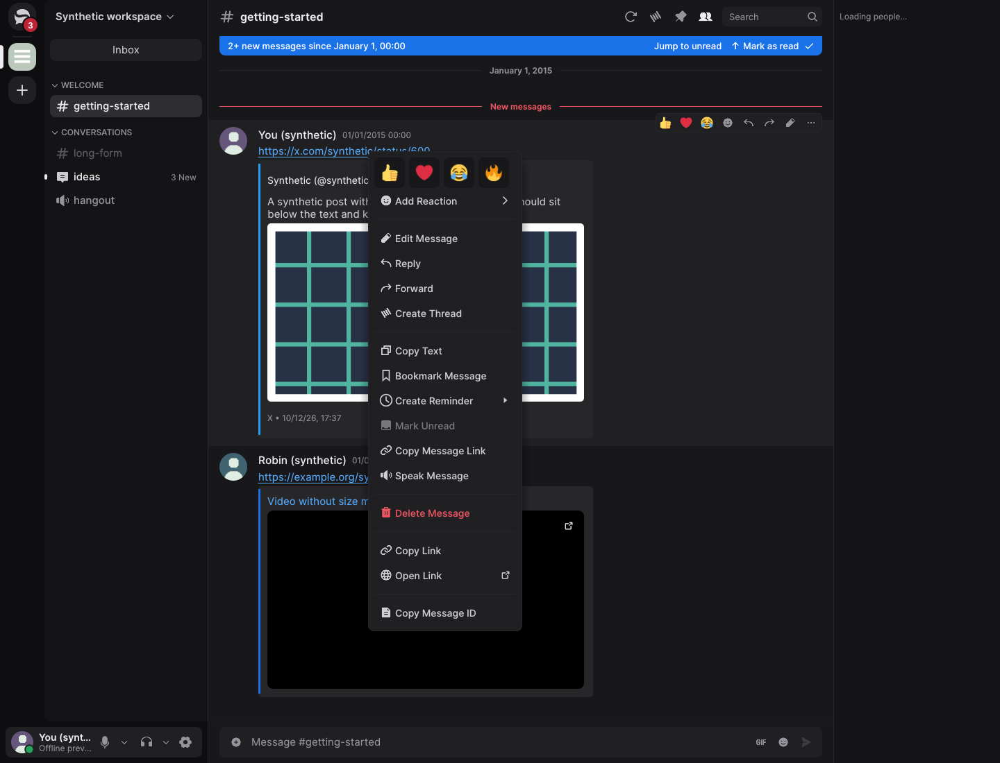
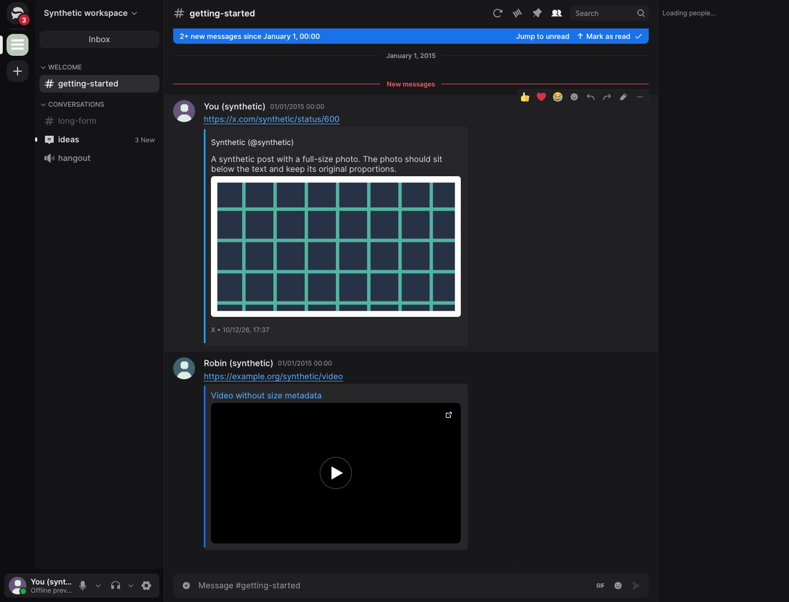
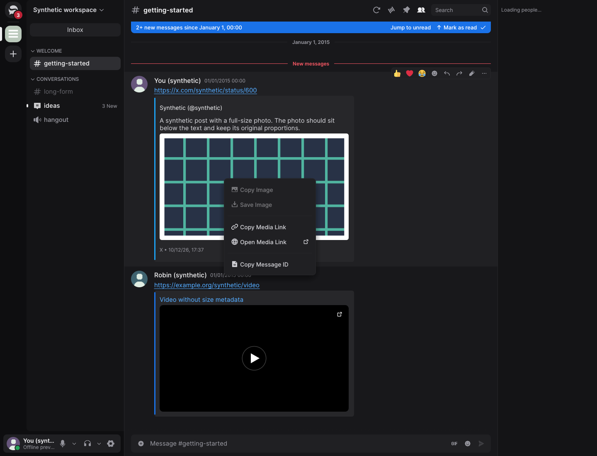

# Conversation and message-menu evidence

## Message menus and performance follow-up — October 22, 2026

The frozen runtime source is `9c42d04be06e08a9d458a05de90c78d31ee478c3`,
compared with the starting PR at `3179696b`, fork baseline `bc35a629` and
published upstream nightly `v1.0.0-nightly.20261022.61` (`c2842aa7`). Later
evidence-only commits do not change the measured runtime. The original mention,
reply, scrolling and time-preference features remain in this PR.

Message, link and image menus now share owner-bound target validation and compact
rows. Link actions retain the exact clicked URL, including signed parameters;
image identifiers refer to their owning message. Message actions use the requested
groups, with additional tools in toolbar overflow. Reminders and Apps reuse the
existing implementations. Message speech is local and independent of microphone
processing. Reporting uses the service-provided, **unofficial** menu and requires
an explicit final Submit; uncertain submissions are not automatically retried.

### Matched native menus

These are synthetic Linux/X11 application-window captures, using the verified
starting-PR and final release previews, dark appearance, Inter fonts, scale 1 and
1440 × 1100 windows. Conversation fixtures use `--demo --interactive
--page=conversation --conversation-qol`; link/image fixtures use `--page=embeds
--media-embeds`. Right-click coordinates match within each pair.

| Starting PR | Final runtime |
| --- | --- |
|  |  |
|  |  |
|  |  |

The image baseline has no image menu; this absence is intentional evidence.
Matched light appearance and narrow 600 × 700-point windows at scale 1.5 were
also captured and inspected locally. Native keyboard checks opened the Reminder
submenu and the image-viewer menu. Offline Copy/Save are unavailable in this
fixture; these images do not establish real clipboard or file-transfer behavior.
Physical displays and Windows/macOS menu rendering remain unverified.

### Results and method

The [performance follow-up](../../performance.md#message-menus-and-performance-follow-up-october-22-2026)
contains separate Linux, Windows and macOS reducer comparisons, local UI/memory
results, package sizes and limitations. The existing [measurement JSON](measurements.json),
under `followup_2026_10_22`, preserves all five repetitions, artifact hashes,
profiles, package probes and revision labels. Earlier top-level results are
historical and are not pooled with the new runs.

Language & Time now schedules the next displayed minute, reuses the frame's clock
snapshot and caches its label/example. Reply/resident byte accounting is incremental;
acknowledgements reuse validated channel lookups, and messages skip edit-only work
when no edit is pending. Native settings CPU is within the two-percentage-point
target, and all three CI reducer medians meet the 3% target against matched fork
baselines. GIF p50 remains slightly higher; p95 is noisy. No overall app speedup
or new GIF allocation improvement is claimed.

The reproducible Linux sampler is [scripts/profile-native-ui.py](../../../scripts/profile-native-ui.py).
For example, in a controlled X11 session with `psutil` and `xdotool` available:

```sh
python scripts/profile-native-ui.py --output /tmp/native.json --only language \
  fork=/path/to/frozen-fork/profile_preview \
  starting_pr=/path/to/frozen-starting-pr/profile_preview \
  after=/path/to/frozen-final/profile_preview
```

Repeat with `--only gif-favorites` and the same output to add that workload. Each
uses one warmup and five rotated measured runs. `--allocation-profile` requires
glibc and a separate output; its instrumented timings are diagnostics only.
The sampler fails if a preview exits during warmup or sampling and identifies its log.

### Verification and remaining checks

Local `cargo xtask check` passed at `d248de43`. The final icon-layout correction
then passed 704 UI tests, strict all-target UI Clippy, workspace formatting and
the production application check. At the frozen runtime revision, native CI
workspace gates passed on Linux, Windows x64/ARM64 and macOS. Login-handoff,
workspace, packaging and speech-asset fixtures, replay, the 120-second soak,
fuzz, licenses, dependency audit and SDK checks passed. See
[runtime-source CI](https://github.com/MCShotty/Serein/actions/runs/39821328166)
for native package status; the JSON records the inspected snapshot separately.

Normal clean/cached Linux packages matched all 592 staged files and modes. Both
launch probes passed with development FFmpeg paths removed and without staging
repair. The packaged LavaSRv2 self-test does not exercise message text-to-speech.
The separate [macOS Nix build](https://github.com/MCShotty/Serein/actions/runs/39821328142)
failed to link `___isPlatformVersionAtLeast` from unchanged capture code; this
toolchain failure is not claimed fixed.

Real platform speech, physical input/display behavior, live OS timezone changes
and live Discord report/permission checks remain unavailable. No live report or
owner session was used. Windows/macOS GUI CPU/RSS and comparative package sizes
remain unmeasured. Canonical extension documentation now identifies toolbar
overflow; wiki generation is checked locally only, leaving the parent wiki untouched.

## Historical initial implementation — October 21, 2026

The sections below describe the earlier implementation and its checks at their
original revisions. Their screenshots are pinned to the original commit; they
must not be read as final menu captures or current-head CI status.

The implementation baseline is fork `main` at
`bc35a629eeed1d80708baf66152bbb0a91005989`. The upstream-nightly comparison is
commit-pinned separately; upstream `main` is not a substitute for a published nightly.

## Synthetic native evidence

The chat fixture covers muted and nested pings, duplicate nicknames, role icons,
member/role suggestion sections and an original outside the active history window.
Both builds receive the same bounded wire fixtures through their ordinary decoders.
The baseline has an example-only fixture/instrumentation overlay; its production sources
are unchanged. These are offline fixtures, not a live Discord conversation.
The normal offline history adapter supplies the original shown in the new capture.

Run the native example explicitly with `--demo`, `--page=conversation`,
`--conversation-qol` and `--interactive`. Language & Time uses `--page=language`.
The matched captures use dark appearance, Inter fonts and scale 1; chat is 1440 × 1100,
and settings are 1120 × 920. Images contain only the synthetic application window.

| Before, fork baseline | After, implementation source |
| --- | --- |
|  |  |
|  |  |

Light appearance and a 900 × 900 conversation were also inspected for clipping and contrast.
Native controls were checked for 12/24-hour switching, Custom timezone activation and region
list presentation. Named/fixed conversion, daylight saving, invalid settings and persistence
are covered by the automated tests; live OS timezone changes remain unverified.

## Measurement method

Release workloads use Rust 1.98.1, the committed lockfile and separate worktree output
directories. Core replay and normal packages use the standard fat-LTO release profile.
Both native UI previews use `cargo rustc --release --locked -p serein
--no-default-features --features demo --example profile_preview -- -C lto=thin`.
They share the same example features, fixture, viewport and renderer. The normal
application package includes voice and its redistribution material.

Each comparison has one warmup and five measured repetitions. Native process samples use
three seconds of startup warmup, five seconds of CPU/RSS sampling at 100 ms intervals and
two seconds of settling. Active UI callback sampling is opt-in through `--metrics`;
natural-idle CPU measurements omit it. Callback percentiles describe `MessagingUi::show`,
not presented frames or physical input latency. Provider/helper processes are counted
separately; these fixtures do not start a provider player.
One initial GIF workload stopped when no visible preview window was found. That workload
alone was repeated with the same binaries/settings; only complete successful samples are used.

The [measurement JSON](measurements.json) retains repetitions, artifact/source hashes,
scroll traces, package/notice checks, current-source CI and clearly labelled historical
macOS results. [Performance details](../../performance.md#conversation-navigation-and-time-preferences-october-21-2026)
include the remaining reducer and time-settings CPU costs. No overall speedup is claimed.

Deterministic scrolling traces exercise the actual adapter at 30/60/144/240 Hz. They
record normalized movement and simulated frame timestamps, rather than physical-device
latency. The production timeline test independently checks reading positions and jump
interruption through rendered variable-height rows.

## Review follow-up

The shared-budget findings were already covered by the unconditional enforcement at the
end of state application. New near-limit regressions cover atomic reply installation and
fetched, live-embedded and history-embedded preview growth. Active targets remain usable;
an evicted Back payload retains its cursor for revalidation.

The follow-up fixes address rejected preview cancellation, fresh input in inactive windows,
wheel ownership in direct scroll areas, active sample scheduling and all 21 new labels in
each of the 12 non-English locales.

Completed visible reply reads also retain bounded attempt markers independently of their
cached bodies. A 500-target regression verifies that eviction cannot restart reads on
repaint or starve later replies. Separate pressure and lifecycle cases cover shared-budget
eviction, explicit Retry, cancellation, edits, permissions and channel changes.

Unknown service mention counts remain hidden until metadata and permissions validate, but
unrelated permission reconciliation no longer discards them before the existing bounded
forum loader returns. Known revocation and explicit removal still retire counts. This does
not scan arbitrary thread archives or remove the existing metadata/navigation limits.

## Verification

The implementation source is `a8b118d1c8944c0df10f5c73c561204933e628c6`.
The full local `cargo xtask check` passed at `9e4e5992`, including 691 UI, 321 desktop
and 18 test-support tests. After the four final core files changed, local core tests
(302 passed, 2 intentionally ignored), strict all-target core Clippy, workspace formatting
and diff checks passed again. Current-source native/application/package CI also passed on
Linux and Windows x64/ARM64, including the full workspace checks.

`cargo xtask fuzz` passed with 153,406 decoder and 4,168 state-transition executions,
31 seconds per target, using the pinned nightly and cargo-fuzz versions. These are bounded
smoke results, not proof of exhaustive coverage. Normal/fuzz license checks, license-policy,
login-handoff, cached-xtask/workspace and Linux/FFmpeg/Flatpak packaging fixtures passed;
their implementation and lockfiles did not change during the final core corrections.
Normal clean/cached Linux packaging reproduced all 592 staged files and modes without
manual repair. The installed app passed both launch probes with development FFmpeg paths
removed. The release lifecycle soak passed over 120 seconds with 55,072 conversation visits
and seven logout cycles; its iteration count is not a performance comparison.

Source CI: <https://github.com/MCShotty/Serein/actions/runs/39615531760>.
The macOS jobs were cancelled without starting; no current-source macOS result is claimed.

## Remaining native checks

Physical wheel/touchpad behavior, monitor/DPI changes, live operating-system timezone
changes and live Discord permissions/navigation need owner-controlled native sessions.
Synthetic results do not establish live Discord interoperability. Windows/macOS GUI,
memory and package-size comparisons are unavailable in this Linux workspace; their CI
core replay comparisons are reported separately.
