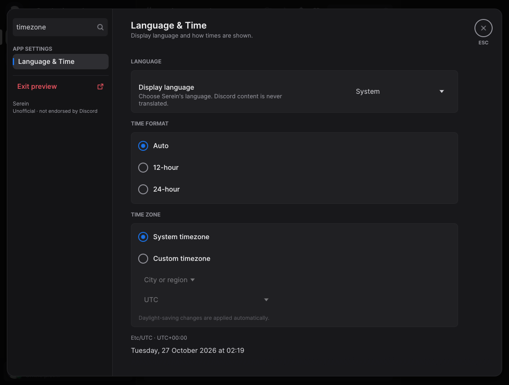
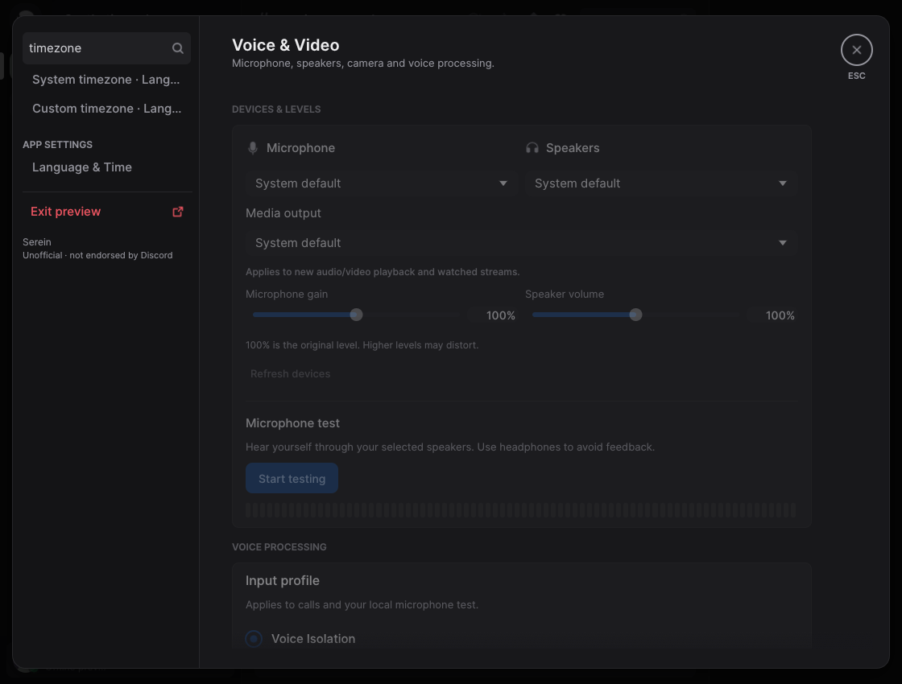
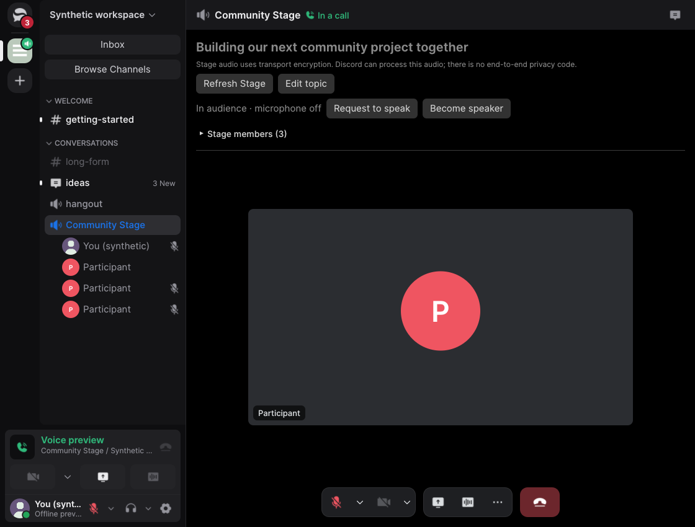
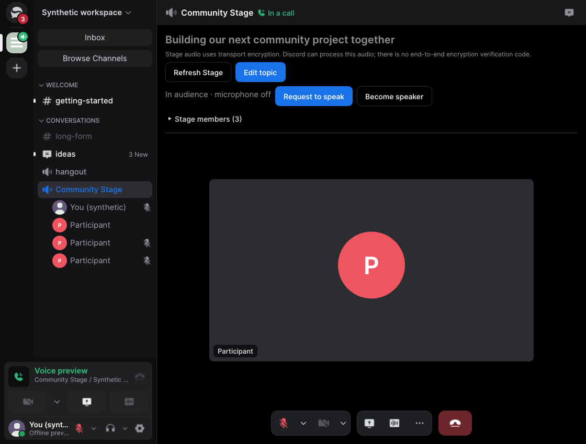
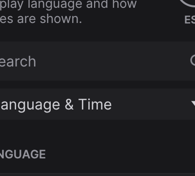
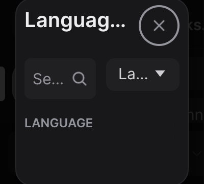

# Desktop UI polish evidence

The inspected base is `3e4b854b54694d4a080770785dcf18557a0fa202`; the implementation
revision is `dd20fca93753d2c387ceb33745d3ea8965379f44`. The previews use synthetic
fixture data and do not connect to Discord or access a microphone. Existing historical
evidence retains its original revision labels.

| Surface | Inspection and disposition |
| --- | --- |
| Navigation and Browse Channels | Inspected the page and synthetic channel preferences. Localized controls and status, exposed all applicable visibility reasons, corrected focus and narrow-row click targets, and retained selection and synchronization semantics. |
| Conversations and composer | Inspected conversation, slash-command and mention fixtures. Localized built-in help and explicit failure feedback; preserved drafts and refreshed language-dependent timeline layout without moving the reading anchor. |
| Media and embeds | Inspected synthetic embed and image/video controls. Localized controls and status, exposed accessible labels, and bounded the image-quality status in a small viewer. Playback and networking remain outside rendering. |
| Members and profiles | Inspected profile, member and moderation fixtures. Localized privacy and profile feedback, corrected server-tag and favorite hints, and preserved the current profile and member review if a replacement request is rejected. |
| Calls and sharing | Inspected synthetic call, Stage and share-dialog fixtures. Localized controls, statuses and disabled reasons; made long source names accessible without overflowing the row. No live call or capture was performed. |
| Settings and dialogs | Inspected account, appearance, chat, Language & Time, server and MFA pages. Search now finds translated control labels and navigates without discarding drafts; compact settings and dialogs fit the viewport, and MFA Enter handling follows the focused field. |
| Server administration and onboarding | Inspected synthetic member, role, safety, application and onboarding pages. Improved blocked-action feedback, localized confirmation and Stage controls, and added keyboard semantics; permissions and mutations remain governed by existing state. |

The UI library suite passed 819 tests with 10 intentionally ignored. The complete
`cargo xtask check` passed 2,384 tests with 36 ignored, strict Clippy, the minimal
application build and policy checks. Login handoff, cached-xtask workspace,
license-policy fixtures, license checks, fuzz smoke, replay and the 120-second offline
soak passed. The soak exercises retained state and lifecycle pressure rather than UI
latency or process RSS.

CI compares the frozen base with upstream nightly `v1.0.0-nightly.20261026.65`
(`38e46b8f5ec694002ef515fbc2d8dc69297e4f5f`); see the PR's Performance section
for results and the unresolved macOS reducer measurement. Native assistive technology,
physical scaling/input, live account behavior, call and microphone checks, and
native-speaker translation review were unavailable. Synthetic fixtures cannot establish
Discord interoperability.

The screenshot pairs use the native synthetic preview under Xvfb with software
rendering and no service adapters. Search and Stage use 1120 × 850 pixels at
100% scale; compact settings uses a window resized to 400 × 360 physical pixels
at 200% scale. The search pair enters the same query from Voice & Video: typing
now keeps the current page open and exposes matching controls for explicit
selection. The compact pair shows the close control remaining reachable; its
settings content is scrollable. Stage controls use the shared design styles.

| Surface | Before | After |
| --- | --- | --- |
| Settings search |  |  |
| Stage |  |  |
| Compact settings |  |  |
