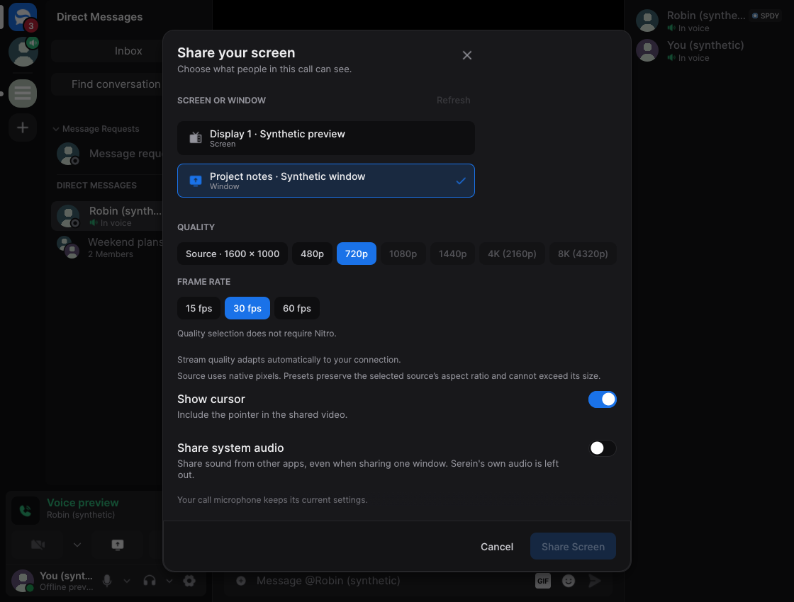
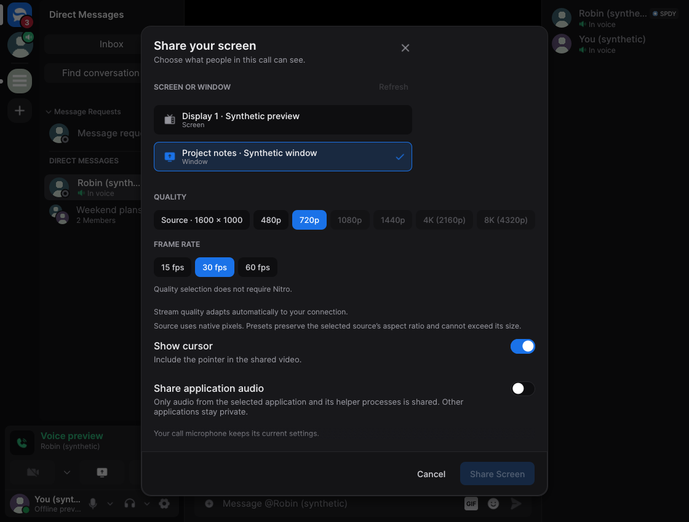

# Gateway recovery and application audio

Local Linux runtime/evidence revision: `f5349e7489708d5e59a7b222065ab9fd5824b022`.
Frozen installer baseline: `e73bb7b0af3b2c902c96f66f50ea7e0cb3007dc9`.
The change is stacked on #27 and retains #26. Neither existing PR is merged here.
The native integration follow-up reuses the shared Windows audio-status setter
and gives voice-crate macOS tests the system Swift runtime rpath. Those fixes
retain the same runtime behavior and leave the Linux UI/replay inputs unchanged.

## Native UI evidence

| Before | After |
| --- | --- |
|  |  |

Both images use the actual native `profile_preview` example, explicit `--demo`,
the screen-share fixture, an application source, 1120 × 850, dark appearance,
scale 1, Mesa llvmpipe and isolated Xvfb. The pointer is outside the window.
The baseline has only the same `--screen-audio-controls` fixture switch backported:
it exposes otherwise hidden demo controls without enabling capture or changing
their implementation. The current example commits that switch. No account,
microphone, portal picker or application capture is opened by this fixture.
Additional native inspection covers light appearance at 800 × 850 and the
760 × 800 layout at 200% scale; those redundant captures are not committed.

The pair establishes the control wording, not native application-audio isolation.
Main-connection diagnostic details and clipboard output are covered by synthetic
UI/transport regressions; no matched native connection-tooltip pair is claimed.

## Checks and boundaries

Pinned Rust 1.98.1, committed lockfiles, and separate task build directories are used.
The final runtime passes `cargo xtask check`: formatting, strict workspace Clippy,
2,322 tests, the minimal application check and policy checks. There are 36 ignored
opt-in tests. The 81 Gateway tests include loopback recovery, buffered ACKs,
rate limiting, exact subscription retry timing, writer capacity, query cancellation
and coalesced send receipts. Native audio fixtures are enabled on their respective
Windows/macOS CI targets; Linux tests do not establish their native result.

Login handoff, cached-xtask workspace/package checks, provider-player fixtures,
FFmpeg/Linux/speech packaging fixtures and license checks run offline.
The bounded fuzz smoke completed 90,734 decoder and 7,893 state-transition
executions, 31 seconds each, with no failing oracle. The 120-second lifecycle
soak completed 2,362 passes and 75,584 channel visits with its retained-state
bounds intact. These ran at `d9735572`; the subsequent Gateway-only freshness
fixes do not change any linked replay/fuzz source. No live account or device
acceptance is inferred from these checks.

The application retains at most 32 fixed-label connection observations and an
8 KiB export. Unchanged frames reuse the cached report; a changed diagnostic
revision refreshes it before UI actions, including rate limits without reconnects.
Account changes clear both owners. The report excludes received error strings,
credentials, payloads and account/source identifiers.

## Comparable measurements

The PR's Performance section records the actual results and artifact provenance.
Common reducer workloads use one warmup and five rotating/alternating measurements
against the frozen installer and the current published upstream nightly pinned to
its source commit. The local comparison reuses hash-verified baseline/nightly
executables with matching Rust/release settings. Current-head CI independently
compares Windows x64, macOS ARM64 and Linux x64; their results stay separate.

Native preview measurements use matching fixture data, viewport, scale, renderer
and release settings, one warmup and five alternating pairs. Callback timing
measures `MessagingUi::show`, not presented-frame/input latency. CPU is a percentage
of one core; process RSS and helper processes are recorded separately. This offline
preview contains no connected Gateway, capture or audio workers. Connected-client
CPU/RSS, real reconnect latency and native audio-isolation performance remain
unmeasured here. Cache occupancy/async-task counts are not inferred from RSS.

Normal local directory packaging is compared with the verified baseline's thin-LTO
build, then repeated from an empty output directory with caches. Executable,
installed payload and deterministic Deflate-6 distribution sizes are compared
within that method. Canonical native CI packages use the committed release profile;
their sizes are not mixed into the local delta. Package checks remove development
FFmpeg paths and verify the shipped native source/recipe/library closure.

## Owner-controlled acceptance

Windows acceptance still needs ordinary/idle use, sleep/wake, network interruption
and simultaneous audio from two applications. A window share must transmit only
its owner and helpers; a monitor share must retain system audio excluding Serein.
Also check Stop/restart, owner exit and leave/rejoin. Application scope can include
other windows/tabs of the same application. Linux window/unknown portal sources
remain explicitly video-only when application identity is unavailable.

The reported dropout's exact cause and physical application-audio isolation are
not established by synthetic success or successful packages. If a dropout remains,
the explicit Copy Issue Diagnostics action retains its fixed connection cause.
