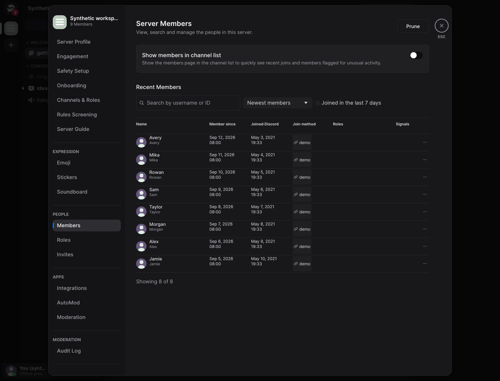
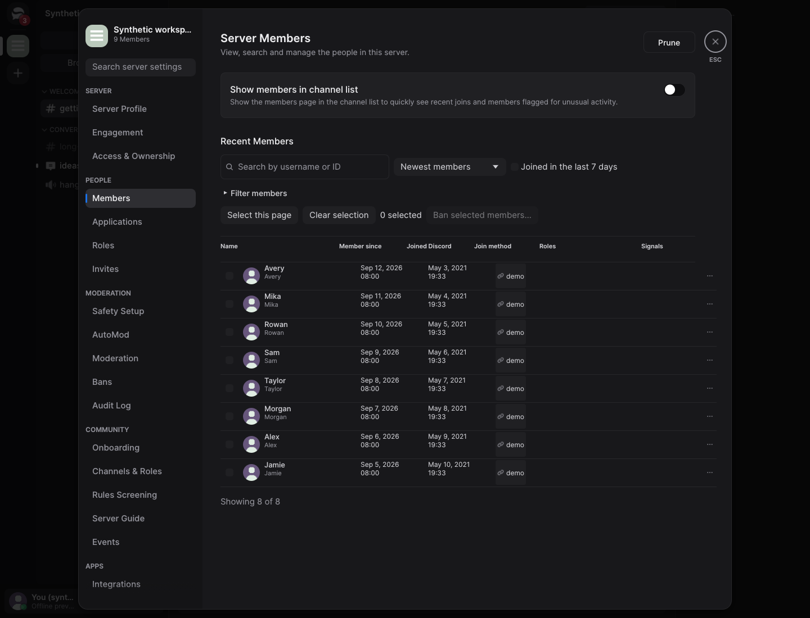
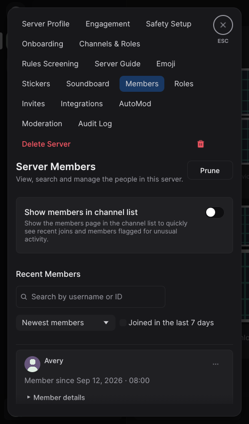
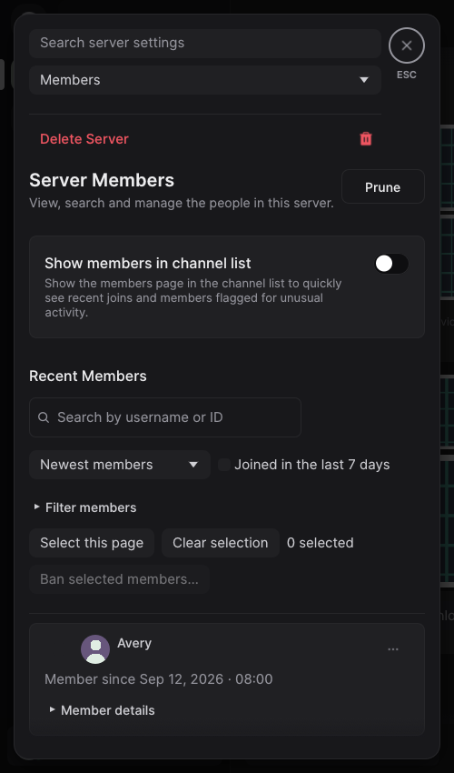

# Server controls and moderation

This work adds account-synced channel visibility and connects native server settings,
member review, moderation, protected actions and community workflows. The detailed protocol
scope and service limitations are in [Discord compatibility](../../discord-compatibility.md#server-administration-and-personal-channel-controls--october-23-2026);
[MFA handling](../../authentication.md) and [session retention](../../storage-policy.md)
describe the authentication and memory boundaries.

## Scope and reproduction

All local validation uses synthetic data. No messages, moderation actions, verification codes,
interviews or ownership transfers were sent to Discord.

- Open a server's **Browse Channels** to search All, Shown or Hidden channels. Hide/show changes
  the saved channel selection; Show All temporarily bypasses that selection. Notification and
  permission settings remain separate. Device-local favorites require an explicit import.
- Open server settings, search for a setting, or use the grouped navigation. Narrow windows
  use a compact navigation picker. Edit conflicts preserve the draft for Reload/Reapply.
- Open **Members**, filter the supplied member data, and open **Mod View**. Its messages and
  audit excerpts have independent loading and bounded history; opening it leaves the conversation
  and read state intact. Actions show the account's actual permissions and eligibility.
- Bulk bans require explicit targets and confirmation. Accepted requests wait for per-member
  completion; unconfirmed outcomes remain unknown. Refresh reads current bans without resending.
- A supported MFA challenge pauses only the rejected request. SMS is sent only on request.
  Passkey-only challenges require another advertised method or official Discord.
- Safety Setup, applications, role preview and integration permissions retain explicit save,
  conflict and confirmation flows. Role preview is read-only and never grants actual access.

Offline native fixtures are available through `profile_preview --demo --interactive` with
`--page=channels`, `server-members`, `mod-view`, `server-roles`, `server-applications`,
`server-access` or `server-mfa`. The MFA fixture intentionally rejects verification and SMS;
it demonstrates the dialog and cancellation, not a successful service challenge.

## Baseline and evidence method

Starting PR #20 is `c7968095aadebe16078f698e8211a470b66caafd`. Its runtime is unchanged from
`26e87fd5908e15dc8f11efd04e57030efb70c731`; the frozen binaries were hashed before use.
The upstream-nightly comparator is immutable tag `v1.0.0-nightly.20261022.61`, commit
`c2842aa762ca633e0ed4ba986c460a59ce6435fe`, selected as the current upstream nightly at the baseline freeze.

Native captures use Linux X11/Xvfb and software rendering, matching viewport, scale and theme
for the paired Members views. New feature fixtures are labeled separately. No physical display,
assistive technology or live account is involved. Images are development evidence and are excluded
from application packaging. Historical evidence elsewhere retains its original revision labels.

Performance results and reproducible methods are recorded in [performance findings](../../performance.md).
Native Windows/macOS GUI CPU/RSS, physical input/accessibility and live Discord acceptance remain
unverified; CI builds and synthetic tests do not establish them.

## Local verification

Runtime source `2ee9314232945685c4dc81dc6cac1fc84c4f179a`, pinned Rust 1.98.1 and committed
lockfiles:

- `cargo xtask check`: passed, including strict workspace Clippy, **2,208 passing tests**,
  36 explicitly ignored tests/doctests, minimal application check and policy checks.
- Strict all-target Clippy with `serein/demo`, followed by the `profile_preview` example tests:
  passed at `5dcaa970` (seven fixture tests); the demo harness is unchanged. The final
  release preview is rebuilt and inspected separately.
- `node tests/login-handoff.cjs`, `node tests/xtask-workspace.cjs` and the six offline
  license-policy fixtures: passed. The dependency-license graph check passed; subsequent
  changes did not change either locked dependency graph.
- Pinned `xtask` fuzz smoke at `5dcaa970`: decode **60,502 runs / 32 seconds** and state
  **1,304 runs / 31 seconds**, with the 512 MiB RSS limit. The already verified cached
  xtask executable selected this invocation's workspace. The generated corpora were removed;
  committed seeds were preserved. Model, protocol, core and fuzz source are unchanged
  in the final UI corrections.
- `cargo replay --soak 120`: passed, **65,664 channel visits**, 39,398,400 live inserts and
  nine logout cycles in 120.063 seconds. Other validation was running concurrently: these
  counts are lifecycle evidence, not a throughput comparison.

Regressions include first-hide preference preservation and cross-client reconciliation,
permissions changing while menus are open, partial/unknown bulk results, exact-operation MFA
continuation, protected-action cancellation, delayed Mod View sections, the two-read ceiling,
stale progress and deleted excerpts, permission-preview isolation, filtered exemption selections,
actual foreground-dialog hit testing/Escape behavior, the Members-menu path to
an actionable Mod View, and the inline draft preview without saving.

## Performance interpretation

The [compact measurements](measurements.json) retain the primary five-run comparison and both
longer confirmation series. The 3% reducer target is **not established on this shared host**:
replay source is pinned to `5dcaa970` and is unchanged by the final UI corrections.
The primary median was +5.5%, a longer wall-time series was +2.8%, and the process-CPU diagnostic
changed direction. Wide-channel batch timing also varied substantially. No causal speedup or
resolved regression is claimed from those inconsistent results. CI's separately labelled native
comparisons are required before treating the reducer target as demonstrated.

The single-process CPU diagnostic uses the difference in `resource.getrusage(RUSAGE_CHILDREN)`
around each completed replay child. Each of five rotated batches averages 20 fixed workload
processes, after one warmup; it includes startup, setup and logout, unlike the reported inner
wide-channel timer. It cannot replace the primary reducer measurement. Both longer series use
logical CPU 2; the primary series uses logical CPU 0. No builds were running during comparisons.

Members idle CPU changed from 4.92% to 5.14% of one core (+0.23 percentage points), within the
two-point target. Settled RSS changed from 150.14 to 151.84 MiB. Active callback p95 increased
from 3.72 to 4.07 ms for member search and from 2.86 to 3.47 ms for the role editor. These are
instrumented UI callbacks, not presented frames or end-to-end input latency. One complete role-editor
batch failed its coverage gate and was repeated once; the rejected attempt and successful repeat
are recorded separately. The final native binaries use runtime `2ee93142`.

Normal clean/cached Linux directory packages matched in content, modes and normalized ZIP hash.
Both passed isolated launch probes without development FFmpeg paths, including private-library
resolution, encoder queries and the synthetic LavaSRv2 worker. No manual staging repair was used.
The executable grew by 1,220,352 bytes (+1.256%) and the normalized ZIP by 496,073 bytes (+0.320%).
An intermediate compiler run exceeded the container memory limit; no measurement is claimed from
that failed attempt. The final normal packaging reruns passed after verified generated test caches
were retired. Full methods, panel measurements and package sizes are in the linked performance section.

## Native evidence

Paired views use the same synthetic eight-member scenario, viewport and scale. The after fixture
adds supplied member/identity/filter metadata; these are development fixtures, not live accounts.
The Mod View captures use the actual Members context-menu entry and a synthetic
transport response. New-only views demonstrate features absent from the starting build. All after captures use the
final measured release preview; no source-code image or fabricated product image is used.

| Members before | Members after |
| --- | --- |
|  |  |

| Narrow before | Narrow after |
| --- | --- |
|  |  |

New views: [Browse Channels](channels.png), [Mod View](mod-view.png) and its [scrolled actions](mod-view-actions.png),
[role preview](role-preview.png), [action verification](mfa.png) and
[application confirmation](application-confirm.png), and the
[inline community preview](community-preview.png).

## Acceptance still requiring an owner/native environment

Live Discord channel-preference synchronization, moderation, application review and MFA have not
been exercised. No live bans, reports, interviews, messages or ownership transfers were submitted.
Windows/macOS interaction, physical DPI/input, assistive technology and actual account/reconnect
acceptance remain unverified. Passkey-only verification hands off to official Discord.
Mod View requires a guild-level moderation permission; channel-overwrite-only voice moderators
retain their existing channel voice actions. Application queues/counts are loaded on demand,
and role preview does not simulate voice suppression, private-thread membership or member-specific
restrictions. Runtime live cache occupancy and outstanding transport workers are not measured by
the fixture sampler; deterministic bounds and cancellation tests cover those contracts.
